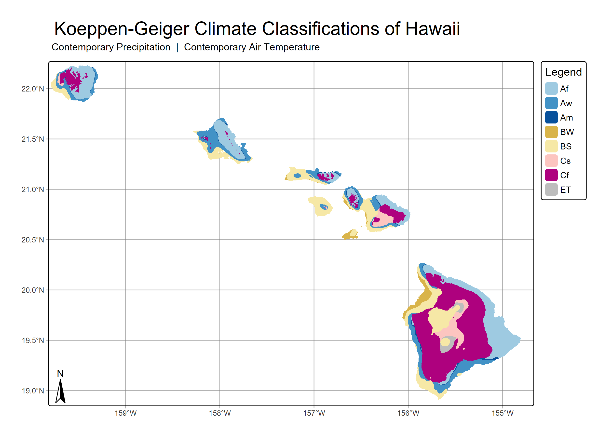

# HIClimClass: Köppen-Geiger Climate Classification of Hawaiʻi

The code classifies every grid cell in Hawaiʻi into a
**Köppen-Geiger climate zone** using mean monthly rainfall and mean monthly air temperature
maps. It does this for two datasets, **contemporary** and **legacy** climatologies, so the
resulting climate-zone maps can be compared.



## What the code does

The Köppen-Geiger system groups climates by their yearly cycle of temperature and precipitation.
Examples are tropical rainforest (Af), monsoon (Am), and steppe (BS). For each dataset, the
workflow:

1. **Loads** 12 monthly rainfall rasters and 12 monthly temperature rasters, each into a
   12-layer raster. Layers are named `P_Jan … P_Dec` and `T_Jan … T_Dec`.
2. **Stacks** them into one 24-layer raster: rainfall (layers 1–12), then temperature
   (layers 13–24).
3. **Classifies** each cell with `ClimClass::koeppen_geiger()`, producing a numeric class code.
   Cells with any missing month, such as ocean cells, become `NA`.
4. **Maps** the result with `tmap`. The map has a categorical Köppen legend, a graticule,
   a north arrow, and a title and subtitle.
5. **Saves** the map as a PNG (300 dpi) and the classified raster as a GeoTIFF in `results/`.

## Data

The data are mean monthly climatology rasters (GeoTIFF, WGS84 / EPSG:4326) for the whole state.
The file names suggest they come from the Hawaiʻi Climate Data Portal (HCDP).

| Folder | Variable | Units | File name pattern |
|---|---|---|---|
| `data/rainfall/contemporary/` | Rainfall | mm | `contemporary_climatology_rainfall_mean_monthly_statewide_<month>.tif` |
| `data/rainfall/legacy/` | Rainfall | mm | `legacy_climatology_rainfall_mean_monthly_statewide_<month>.tif` |
| `data/temperature/contemporary/` | Mean air temperature | °C | `contemporary_climatology_mean_air_temperature_mean_monthly_statewide_<month>.tif` |
| `data/temperature/legacy/` | Mean air temperature | °C | `legacy_climatology_mean_air_temperature_mean_monthly_statewide_<month>.tif` |

`<month>` is the lowercase full month name (`january` … `december`).

## Repository structure

```
HIClimClass/
├── hawaii_climate_classification.Rproj   # RStudio project (sets working directory to repo root)
├── README.md
├── LICENSE
└── KoppenGeigerClassifications/
    ├── R/
    │   └── kg_functions.R        # all functions: loading, classification, mapping, workflow
    ├── analysis/
    │   └── analysis.R            # main script (run this)
    ├── data/
    │   ├── rainfall/{contemporary,legacy}/
    │   └── temperature/{contemporary,legacy}/
    └── results/
        ├── contemp_prcp_contemp_temp.png / .tif
        └── legacy_prcp_legacy_temp.png / .tif
```

## Functions (`R/kg_functions.R`)

| Function | Purpose |
|---|---|
| `month_labels(month_format)` | Returns the 12 month names in the format used in the file names (`"lower"` → `january`, `"abb"` → `Jan`, `"num2"` → `01`, and others). |
| `load_source(data_dir, pattern, month_format, prefix)` | Reads 12 monthly GeoTIFFs into one 12-layer `SpatRaster`, with layers named `<prefix>_Jan … <prefix>_Dec`. |
| `stack_prcp_temp(prcp, temp)` | Checks that both inputs have 12 correctly named layers, then stacks rainfall followed by temperature. |
| `classify_kg_cell(kg_inputs)` | Classifies one cell from its 24 values using `ClimClass::koeppen_geiger()`. Returns `NA` if any value is missing. |
| `classify_kg(kg_inputs)` | Applies `classify_kg_cell` to every cell with `terra::app()`. Returns a raster named `kg_class`. |
| `map_kg_zones(kg, subtitle)` | Converts class codes to Köppen labels and builds the `tmap` map with a fixed color for each class. |
| `run_kg_workflow(prcp_dir, prcp_pattern, temp_dir, temp_pattern, subtitle, file_name, output_dir, save_png, save_geotiff)` | Runs the whole pipeline (load → stack → classify → map → save) and returns the classified raster. |

### Class codes

| Code | 11 | 12 | 13 | 21 | 22 | 31 | 32 | 33 | 41 | 42 | 43 | 51 | 52 |
|---|---|---|---|---|---|---|---|---|---|---|---|---|---|
| Class | Af | Aw | Am | BW | BS | Cs | Cw | Cf | Ds | Dw | Df | ET | EF |

## R packages used

| Package | What it's used for |
|---|---|
| **terra** | Reading GeoTIFFs (`rast`), stacking layers (`c`), checking layers (`nlyr`), cell-by-cell classification (`app`), and writing GeoTIFFs (`writeRaster`). |
| **ClimClass** | `koeppen_geiger()`, which assigns a Köppen-Geiger class from monthly precipitation and temperature. |
| **tmap** (v4) | The classification map (`tm_shape`, `tm_raster`, `tm_scale_categorical`, `tm_legend`, `tm_graticules`, `tm_title`, `tm_compass`) and saving it as a PNG (`tmap_save`). |

## How to run

### 1. Install R and the packages

Any R installation works. To use [pixi](https://pixi.sh) (for example, under WSL/Linux):

```bash
pixi add r-base r-terra r-tmap
# ClimClass is not on conda-forge, so install it from CRAN:
pixi run Rscript -e 'install.packages("ClimClass", repos="https://cloud.r-project.org")'
```

To use plain R or RStudio instead, run:

```r
install.packages(c("terra", "tmap", "ClimClass"))
```

### 2. Run the analysis

All paths are relative to the **repository root** (`HIClimClass/`).

- **RStudio:** open `hawaii_climate_classification.Rproj`, then run `KoppenGeigerClassifications/analysis/analysis.R`.
- **VS Code or the R console:**

  ```r
  setwd("path/to/HIClimClass")
  source("KoppenGeigerClassifications/analysis/analysis.R")
  ```

`analysis.R` loads the packages and functions itself, then runs the workflow twice:

| Output object | Data used | Saved files |
|---|---|---|
| `contemp_prcp_contemp_temp` | Contemporary rainfall and contemporary temperature | `results/contemp_prcp_contemp_temp.png` / `.tif` |
| `legacy_prcp_legacy_temp` | Legacy rainfall and legacy temperature | `results/legacy_prcp_legacy_temp.png` / `.tif` |

Classification runs once per land cell, so a full run takes a few minutes.

## Notes and limitations

- **Temperature input.** `ClimClass::koeppen_geiger()` expects minimum (`Tn`), maximum (`Tx`),
  and mean (`Tm`) temperature, but the Köppen-Geiger calculation only uses the mean. The code
  passes mean temperature into all three columns as placeholders.
- **Main classes only.** The map shows the main Köppen classes (for example `Cf`, `BS`), not
  the full three-letter subtypes (for example `Cfb`).
- **Results are overwritten.** Running `analysis.R` overwrites the files in `results/`. If you
  only ran the code and didn't change it, run `git restore KoppenGeigerClassifications/results/`
  before committing.

## License

GPL-3.0. See `LICENSE`.
