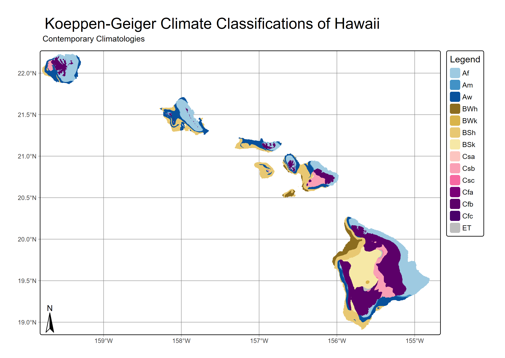

# HIClimClass: Köppen-Geiger Climate Classification of Hawaiʻi

The code classifies every grid cell in Hawaiʻi into a
**Köppen-Geiger climate zone** using mean monthly rainfall and mean monthly air temperature
maps. It does this for two datasets, **contemporary** and **legacy** climatologies and for **eight future
climate scenarios** (four SSPs, each for mid-century and end of century), so the
resulting climate-zone maps can be compared.



## What the code does

The Köppen-Geiger system groups climates by their yearly cycle of temperature and precipitation.
Examples are tropical rainforest (Af), monsoon (Am), and hot steppe (BSh). For each dataset, the
workflow:

1. **Loads** 12 monthly rainfall rasters and 12 monthly temperature rasters, each into a
   12-layer raster. For the legacy and
   contemporary data, 12 single-month files are combined (`load_source()`). The future
   projections already come as one 12-layer file per variable.
2. **Aligns** the future rasters. If their longitudes run 0–360°, they are shifted to −180–180°
   to match the other data.
3. **Classifies** the rasters with `macroBiome::cliKoppenGrid()`, which assigns a full
   Köppen-Geiger subtype (for example `Cfb`, `BSh`, `Csa`) to every cell. The numeric codes are
   then labelled with the class names.
4. **Maps** the result with `tmap`. The map has a categorical Köppen legend with a fixed color for each class, a graticule, a north arrow, and a title and subtitle.
5. **Saves** the map as a PNG (300 dpi) and the classified raster as a GeoTIFF in `results/`.

## Data

All data are mean monthly rasters (GeoTIFF) for the whole state. The data files are **not
stored on GitHub** because they are too large. Get them from the project's shared OneDrive
folder: **HCDP** for the legacy and contemporary data, and **Thrasher_etal_Projections** for
the future data. Place them in the folders below.

**Legacy and contemporary climatologies.** The file names suggest these come from the Hawaiʻi
Climate Data Portal (HCDP).

| Folder | Variable | Units | File name pattern |
|---|---|---|---|
| `data/rainfall/contemporary/` | Rainfall | mm | `contemporary_climatology_rainfall_mean_monthly_statewide_<month>.tif` |
| `data/rainfall/legacy/` | Rainfall | mm | `legacy_climatology_rainfall_mean_monthly_statewide_<month>.tif` |
| `data/temperature/contemporary/` | Mean air temperature | °C | `contemporary_climatology_mean_air_temperature_mean_monthly_statewide_<month>.tif` |
| `data/temperature/legacy/` | Mean air temperature | °C | `legacy_climatology_mean_air_temperature_mean_monthly_statewide_<month>.tif` |

`<month>` is the lowercase full month name (`january` … `december`).

**Future projections.** These are multi-model ensemble (MME) monthly means from the Thrasher
et al. projections. Each file holds 12 monthly layers.

| Folder | Variable | File name pattern |
|---|---|---|
| `data/rainfall/future/mid/` | Rainfall | `MME_MID_<ssp>_MONTHLY_pr_mean.tif` |
| `data/rainfall/future/end/` | Rainfall | `MME_END_<ssp>_MONTHLY_pr_mean.tif` |
| `data/temperature/future/mid/` | Mean air temperature | `MME_MID_<ssp>_MONTHLY_tas_mean.tif` |
| `data/temperature/future/end/` | Mean air temperature | `MME_END_<ssp>_MONTHLY_tas_mean.tif` |
 
`<ssp>` is `ssp126`, `ssp245`, `ssp370`, or `ssp585`. **SSP** (Shared Socioeconomic Pathway) is
the standard set of IPCC/CMIP6 future scenarios. The first number is the socioeconomic
storyline (1 = sustainability … 5 = fossil-fueled development). The second is the radiative
forcing in 2100 in W/m²; higher means more warming. **MID** and **END** are mid-century and end
of century.

## Repository structure

```
HIClimClass/
├── hawaii_climate_classification.Rproj   # RStudio project (sets working directory to repo root)
├── README.md
├── LICENSE
└── KoppenGeigerClassifications/
    ├── R/
    │   └── macroBiome.R            # all functions: loading, classification, mapping, run_kgc()
    ├── analysis/
    │   └── macroBiome_analysis.R   # main script (run this)
    ├── data/                       # not on GitHub (see Data)
    │   ├── rainfall/{contemporary,legacy}/
    │   ├── rainfall/future/{mid,end}/
    │   ├── temperature/{contemporary,legacy}/
    │   └── temperature/future/{mid,end}/
    └── results/
        ├── legacy_kgc.png / .tif
        ├── contemporary_kgc.png / .tif
        └── ssp<126|245|370|585>_<mid|end>_kgc.png / .tif
```
 

## Functions (`R/kg_functions.R`)

| Function | Purpose |
|---|---|
| `month_labels(month_format)` | Returns the 12 month names in the format used in the file names (`"lower"` → `january`, `"abb"` → `Jan`, `"num2"` → `01`, and others). |
| `load_source(data_dir, pattern, month_format, prefix)` | Reads 12 monthly GeoTIFFs into one 12-layer `SpatRaster`, with layers named `<prefix>_Jan … <prefix>_Dec`. |
| `classify_kgc(temp, prcp, file_name)` | Classifies the 12-layer temperature and precipitation rasters with `macroBiome::cliKoppenGrid()`, attaches the class names, and saves `<file_name>.tif`. |
| `map_kgc(result, file_name, map_subtitle)` | Builds the `tmap` map with a fixed color for each class and saves `<file_name>.png`. |
| `run_kgc(temp, prcp, file_name, map_subtitle)` | Runs the whole pipeline for one scenario (load if given a file path → shift longitudes if needed → classify → map → save). |

### Class codes

The 30 Köppen-Geiger classes come from `macroBiome::vegClsNumCodes`:
 
| Code | 1 | 2 | 3 | 4 | 5 | 6 | 7 | 8 | 9 | 10 | 11 | 12 | 13 | 14 | 15 |
|---|---|---|---|---|---|---|---|---|---|---|---|---|---|---|---|
| Class | Af | Am | Aw | BWh | BWk | BSh | BSk | Csa | Csb | Csc | Cwa | Cwb | Cwc | Cfa | Cfb |
 
| Code | 16 | 17 | 18 | 19 | 20 | 21 | 22 | 23 | 24 | 25 | 26 | 27 | 28 | 29 | 30 |
|---|---|---|---|---|---|---|---|---|---|---|---|---|---|---|---|
| Class | Cfc | Dsa | Dsb | Dsc | Dsd | Dwa | Dwb | Dwc | Dwd | Dfa | Dfb | Dfc | Dfd | ET | EF |
 
The map legend shows only the classes that actually occur in each map.

## R packages used

| Package | What it's used for |
|---|---|
| **terra** | Reading GeoTIFFs (`rast`), shifting longitudes (`shift`), and writing GeoTIFFs (`writeRaster`). |
| **macroBiome** | `cliKoppenGrid()`, which assigns a Köppen-Geiger class to every cell from monthly temperature and precipitation rasters; `vegClsNumCodes` for the class names. |
| **tmap** (v4) | The classification map (`tm_shape`, `tm_raster`, `tm_scale_categorical`, `tm_legend`, `tm_graticules`, `tm_title`, `tm_compass`) and saving it as a PNG (`tmap_save`). |

## How to run

### 1. Install R and the packages

Any R installation works. To use [pixi](https://pixi.sh) (for example, under WSL/Linux):

```bash
pixi add r-base r-terra r-tmap r-devtools
# macroBiome is not on conda-forge, so install it from CRAN:
pixi run Rscript -e 'install.packages("macroBiome", repos="https://cloud.r-project.org")'
```
 
`macroBiome` depends on `devtools`, which is why `r-devtools` is installed from conda-forge
first. Building it from CRAN often fails on Linux.
 
To use plain R or RStudio instead, run:
 
```r
install.packages(c("terra", "tmap", "macroBiome"))
```

### 2. Run the analysis

All paths are relative to the **repository root** (`HIClimClass/`).

- **RStudio:** open `hawaii_climate_classification.Rproj`, then run `KoppenGeigerClassifications/analysis/macroBiome_analysis.R`.
- **VS Code or the R console:**

  ```r
  setwd("path/to/HIClimClass")
  source("KoppenGeigerClassifications/analysis/macroBiome_analysis.R")
  ```

- **Terminal (with pixi):**
```bash
  cd path/to/HIClimClass
  pixi run --manifest-path path/to/pixi.toml Rscript KoppenGeigerClassifications/analysis/macroBiome_analysis.R
```
 
`macroBiome_analysis.R` loads the packages and functions itself, then runs the workflow
10 times:
 
| Output (`results/`) | Data used | Map subtitle |
|---|---|---|
| `legacy_kgc` | Legacy rainfall and temperature | Legacy Climatologies |
| `contemporary_kgc` | Contemporary rainfall and temperature | Contemporary Climatologies |
| `ssp126_mid_kgc`, `ssp126_end_kgc` | SSP1-2.6 (low emissions) | Mid-Century / End-of-Century |
| `ssp245_mid_kgc`, `ssp245_end_kgc` | SSP2-4.5 (intermediate) | Mid-Century / End-of-Century |
| `ssp370_mid_kgc`, `ssp370_end_kgc` | SSP3-7.0 (high) | Mid-Century / End-of-Century |
| `ssp585_mid_kgc`, `ssp585_end_kgc` | SSP5-8.5 (very high) | Mid-Century / End-of-Century |
 
Each output is saved as a `.png` map and a `.tif` raster. A full run takes several minutes.

## Notes and limitations

- **Memory.** Running all 10 scenarios in one R session uses a lot of memory, and R may be
  stopped with "Killed". On WSL, raise the limit in `%USERPROFILE%\.wslconfig` (for example
  `memory=12GB`) and run `wsl --shutdown`. Or run the remaining `run_kgc(...)` calls in a fresh
  R session after loading the packages and sourcing `R/macroBiome.R`.
- **`Rplots.pdf`.** When the script is run with `Rscript`, the maps it prints are also written
  to `Rplots.pdf`. This file can be deleted.
- **Results are overwritten.** Running `macroBiome_analysis.R` overwrites the files in
  `results/`. If you only ran the code and didn't change it, run
  `git restore KoppenGeigerClassifications/results/` before committing.

## Reproducibility check
 
- 2026-10-23: Full workflow rerun successfully on WSL Ubuntu with pixi (R 4.5.3). All 10 maps
  reproduced. The end-of-century runs were done in a separate session because of the memory
  limit.


## License

GPL-3.0. See `LICENSE`.
